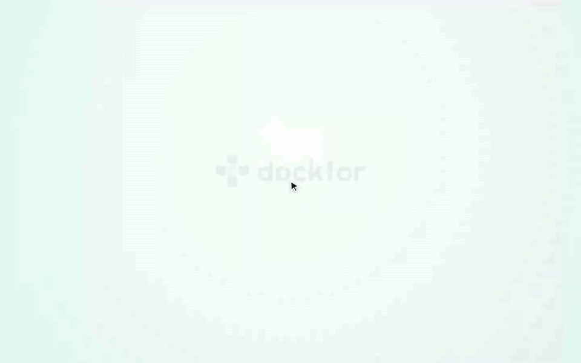
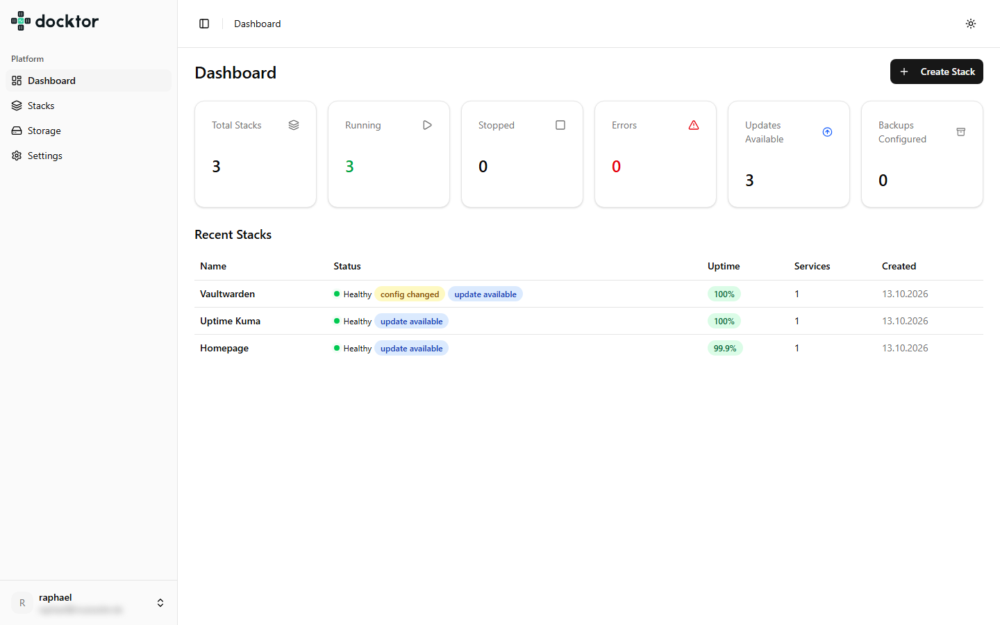
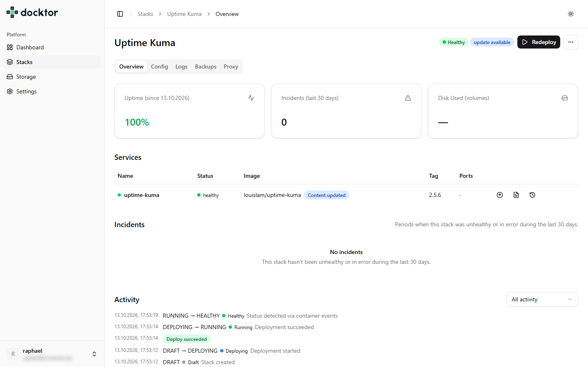
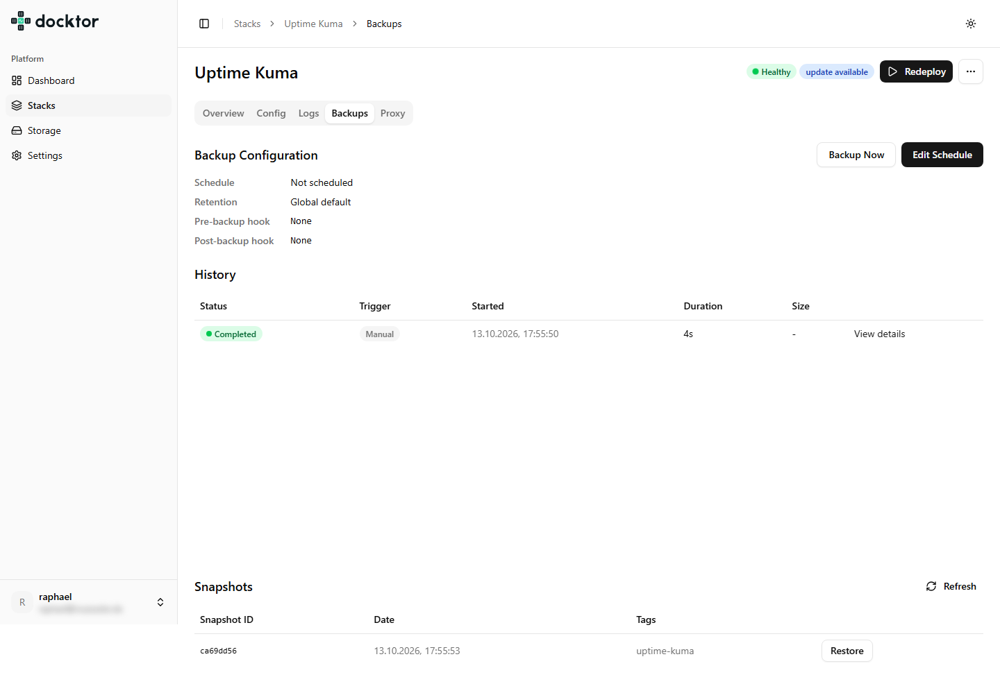

<p align="center">
  <picture>
    <source media="(prefers-color-scheme: dark)" srcset="docs/branding/docktor-logo-light.svg">
    
  </picture>
</p>

# Docktor

Docktor is a browser UI to deploy, update, monitor and back up Docker Compose apps on your own server, with no SSH needed for day-to-day operation.

<p align="center">
  
</p>

## What it does

- **Stacks with compose review**: create a stack from a compose file, review the YAML in an editor, and deploy, stop or restart it from the browser.
- **Templates**: start Nextcloud, Vaultwarden, Gitea and other apps from a ready-made template.
- **Live status and logs**: container state and service logs stream into the page as they change.
- **Update checks**: Docktor watches the registries for newer image tags and upgrades a service when you ask.
- **Backups with restic**: scheduled and manual backups into a per-stack local repository, with restore.
- **Proxy and TLS**: assign domains to services, with automatic Let's Encrypt certificates or your own.
- **Health, uptime and storage**: HTTP health probes with uptime and incidents, and disk usage per stack.
- **Account security**: two-factor authentication, recovery codes and sign-in rate limiting.

## Screenshots



*Dashboard: every stack and its status at a glance.*



*Stack detail: services, live status and the activity timeline.*



*Backups: schedule and snapshot history.*

## Quickstart

Docktor runs as two containers (the app and its Postgres database) from a published image. You need a Linux host with Docker Engine and the Compose plugin.

```bash
# 1. Create the directories
sudo mkdir -p /opt/docktor/stacks && cd /opt/docktor

# 2. Fetch the compose file and the environment template (saved as .env)
curl -fsSL -o docker-compose.yml https://raw.githubusercontent.com/docktor-app/docktor/v0.1.0/docker-compose.yml
curl -fsSL -o .env https://raw.githubusercontent.com/docktor-app/docktor/v0.1.0/.env.example

# 3. Replace every CHANGE_ME value in .env; generate each secret with:
openssl rand -hex 32

# 4. Start Docktor
docker compose up -d
```

Then open the URL you set in `BETTER_AUTH_URL`; a fresh instance sends you to the setup wizard. The database password appears twice in `.env` (`DATABASE_URL` and `POSTGRES_PASSWORD`) and both must match. The full walkthrough is in the [Get started guide](https://github.com/docktor-app/docks/blob/main/guide/get-started.md).

## Documentation

- [Documentation home](https://github.com/docktor-app/docks)
- [Get started](https://github.com/docktor-app/docks/blob/main/guide/get-started.md)
- [Deployment reference](https://github.com/docktor-app/docks/blob/main/reference/deployment.md): environment variables, startup checks, upgrades and troubleshooting
- [Security](https://github.com/docktor-app/docks/blob/main/security.md): what the Docker socket mount means and how to harden an instance

## Contributing

Contributions are welcome. Read [CONTRIBUTING.md](CONTRIBUTING.md) for the development setup and the pull request checklist, and follow the [Code of Conduct](CODE_OF_CONDUCT.md).

## Security

To report a vulnerability, follow [SECURITY.md](SECURITY.md). Never open a public issue for a security problem.

## License

Docktor is released under the [MIT License](LICENSE).
